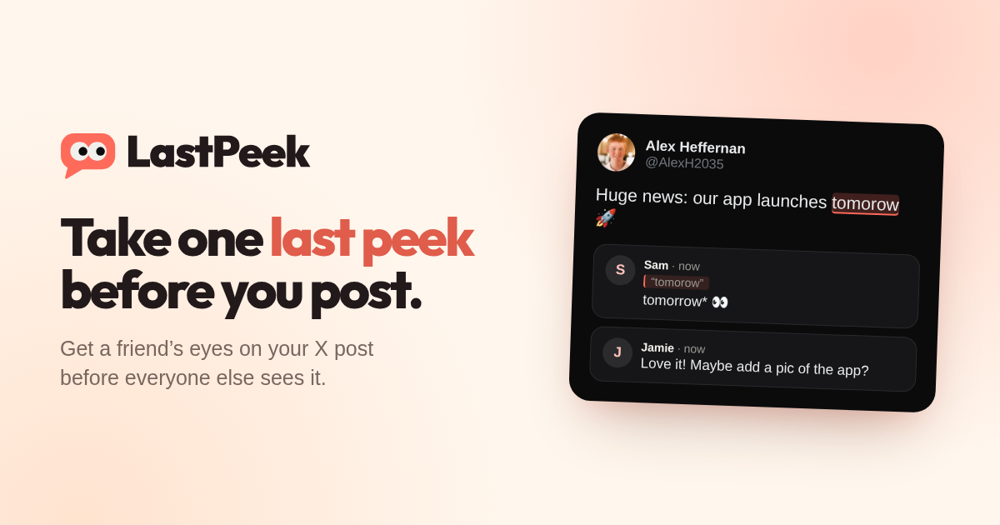

# LastPeek

**Better posts, with a little help from your friends.**

LastPeek is a place to draft your X posts and get a second opinion before they go out. Write a post or thread, add your photos or video, and send friends one link. They can highlight words and leave feedback without creating an account. Make a few tweaks, then post when you’re ready.

**[Join the waitlist](https://lastpeek.alexheffernan.dev/#waitlist)** · [Watch the walkthrough](https://lastpeek.alexheffernan.dev/#how) · [Sign in](https://lastpeek.alexheffernan.dev/login) · [Self-host](docs/development.md)

The hosted app is currently invite-only. Joining the waitlist requests an invitation; it doesn’t create an account. You can also run your own instance.

## Catch the typo before the replies do

I often send friends a post for a second opinion before it goes out. Usually that meant copying text or taking screenshots, which got messy once photos were involved, and their replies got buried in the group chat.

So I built LastPeek. The post, its media and the conversation stay together, with one link that keeps up as you edit.

Made by [Alex Heffernan](https://x.com/AlexH2035).

## Write it. Share it. Fix it. Post it.

1. **Write it.** Compose directly in an X-style post layout, with threads, photos, GIFs and video. See the text, media and character counts together as you write. Your edits save automatically.
2. **Share it.** Drop a review link in the group chat. Friends open it and comment with just a name. For a more private review, invite specific friends with LastPeek accounts instead.
3. **Fix it.** Talk through their notes beside the draft. Keep editing without sending another link. Feedback stays attached to what they actually reviewed, even when you change the wording or remove an attachment.
4. **Post it.** Copy individual posts and download your media to finish in X, or use Pro to publish directly. Your draft and its discussion stay in LastPeek afterwards.

[See it in under a minute →](https://lastpeek.alexheffernan.dev/#how)

## A second opinion, without the screenshot shuffle

### Feedback that points to something

“This bit feels off” is more useful when you can see which bit. Reviewers can comment on selected words, a whole post, an image or a moment in a video. Reply in the same discussion, react to a helpful note, and resolve conversations when you’re done. If the draft changes, you can compare the original context with the current version.

### One link that keeps up

Your review link stays the same as you revise. Friends opening it see the latest saved version, while earlier feedback keeps its original context. Remove the link when you no longer want it to work, without removing access for separately invited reviewers.

### A post, not a document

Write in the layout your friends will review: profile, text, thread connectors and media together. There’s no separate preview mode to switch into. Threads support up to 25 posts, with X’s weighted character counts for links and Unicode.

### Your turn, their turn, done

Keep your own work in **Drafts**, friends’ requests in **To review**, and finished work in **Done**. Feedback on the current version clears a review from the queue; a new shared edit brings it back for another look. In-app notifications take you straight to the conversation.

### Made for your phone too

Write, upload, share and review on mobile as well as desktop. Add LastPeek to your Home Screen for an app-like window and opt into feedback notifications on supported devices. Choose Light, Dark or Auto appearance. You’ll still need an internet connection; drafts aren’t cached for offline use.

## A little more help, if you want it

The complete human-feedback workflow is available on Free. You don’t need a connected X account, an AI provider or an agent to use it.

**Pro adds X tools.** Publish posts and threads directly, prepare replies and quotes with the original post in view, and look up @mentions while writing. Direct publishing requires a connected X account and your confirmation. These tools depend on the instance’s X configuration and your available usage allowance.

**Pro also adds private AI review.** Choose Quick review, Proofread, Clarity, Tighten, Tone or Thread flow. Results stay private to you, separate from your friends’ discussion. Suggestions never change your words automatically. AI review is optional and sends post text to OpenAI only when requested, not your media or discussion.

**Already work with an agent?** When the Agents trial is enabled for your account, connect a compatible remote MCP client to prepare drafts, work with media and exchange feedback in LastPeek. You choose its permissions and can revoke them at any time. Agents can’t publish to X or delete your drafts. See the [connection guide](docs/agents.md).

### Free and Pro

|                                   | Free   | Pro                                    |
| --------------------------------- | ------ | -------------------------------------- |
| Saved drafts                      | 10     | 100                                    |
| Media storage                     | 250 MB | 2,048 MB                               |
| Posts, threads and media          | Yes    | Yes                                    |
| Guest reviews and invited friends | Yes    | Yes                                    |
| Discussions and notifications     | Yes    | Yes                                    |
| Copy posts and download media     | Yes    | Yes                                    |
| Direct X publishing and X tools   | No     | Subject to configuration and allowance |
| Private AI review                 | No     | Subject to configuration and allowance |

These are the default allowances; instance owners can adjust them. Free has no time limit. Pro is currently an owner-managed trial, with no checkout or automatic charges. Your account’s Settings shows its actual limits and remaining usage.

## Private until you share

Drafts start visible only to you. When you’re ready, choose how to share:

- **Review link:** anyone with the link can read and comment, without an account. It’s unlisted, not restricted to the people you send it to.
- **Invited friends:** only the selected, signed-in friends can open that invitation. Forwarding its address doesn’t grant access.

You can use both on the same draft and remove either independently. Removing an invitation doesn’t block someone who also has an active review link.

Shared links can show a preview of your post and media in messaging apps. Revoking access stops future access through LastPeek, but can’t recall downloaded copies or previews another service has retained. See [security and privacy boundaries](SECURITY.md) for the details.

## Open source. Yours to run.

LastPeek runs as one SvelteKit application with PostgreSQL and a private media directory. No hosted authentication, email service, cloud storage, analytics or paid social API is required for drafting and human review. The official instance runs on a Raspberry Pi; Docker builds support AMD64 and ARM64.

For your own domain, build from source with your own origin rather than repointing the official image.

- **[Development and self-hosting](docs/development.md):** local setup, Docker, optional integrations and recovery.
- **[Deployment guide](docs/deployment.md):** HTTPS, persistent storage, backups and the official service’s update process.
- **[Agent connections](docs/agents.md):** permissions, tools and media workflows.
- **[Contributing](CONTRIBUTING.md):** help improve LastPeek, or [open an issue](https://github.com/AlexanderHeffernan/LastPeek/issues) for a bug or idea. Please [report security issues privately](SECURITY.md).
- **[Product scope](docs/product.md) · [Architecture](docs/architecture.md) · [Design](docs/design.md) · [Operations](docs/operations.md):** how the project fits together.

## Licence

Copyright © 2026 Alexander Heffernan. Licensed under [GNU AGPL version 3 only](LICENSE), without warranty. You may self-host, modify and offer services under its terms, including the corresponding-source obligations for modified network services. Dependencies retain their own licences and notices. The LastPeek name and logo don’t grant permission to imply an official service or endorsement. LastPeek is not affiliated with X.
